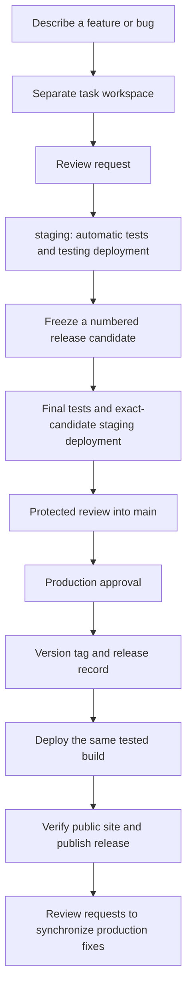

# GitHub Release Guardian

## Quick start

1. Open your project in your AI coding agent.
2. Ask: **“Install GitHub Release Guardian from this folder for this project.”** Give the agent this package's location.
3. Ask: **“Set up my GitHub project.”** The agent inspects first and shows you what needs attention.
4. Approve the proposed setup when you are ready. A project administrator sets GitHub protections, and your hosting account needs a separate testing environment.
5. Ask: **“Start working on a new feature.”**

Have a technical helper? From this package, install into a different project:

```sh
python3 scripts/install.py --agent codex --project /absolute/path/to/your-project
```

Then say **“Use $github-release-guardian to set up my GitHub project.”**
For Claude use `--agent claude`; for Google Antigravity use `--agent antigravity`.
[Installation guides](docs/installation/generic.md) cover installation for all projects, updates, removal, and optional shortcuts.

## What it does

Guardian helps your AI agent save work, send it for testing, release a verified version, and leave clear notes for the next person. You explain what you want. The agent handles GitHub details. GitHub checks and human reviews control important actions.

A **branch** is a separate workspace for a change. A **pull request** asks the team to review and combine that change. **Staging** is a separate testing copy of your project. A **release** is a numbered public version.



## Things you can say

| Say this | What happens |
| --- | --- |
| “Set up my GitHub project.” | Inspect access, testing, hosting, and safety settings; prepare a setup plan. |
| “Add Google login.” | Start a feature workspace from the testing version. |
| “Fix the broken checkout.” | Start a bug-fix workspace. |
| “Save my progress.” | Review and save selected files locally, with handoff notes. |
| “Send my changes for testing.” | Create or update a review request into staging. |
| “Is staging ready?” | Check the current tests and testing deployment. |
| “What changed since the last release?” | Read the actual change history and explain it. |
| “Release the latest tested changes.” | Prepare a numbered candidate, follow checks and reviews, and request protected production deployment. |
| “Fix this urgent production problem.” | Start from the current public version and keep required reviews. |
| “What's completed and pending?” | Summarize work, failed checks, reviews, and deployments. |
| “Continue where the last agent stopped.” | Read current handoffs and GitHub state, then resume. |

Optional `/github-setup`, `/github-status`, `/github-start`, `/github-save`, `/github-submit`, `/github-test`, `/github-release`, `/github-hotfix`, `/github-sync`, and `/github-help` aliases are installable for Claude and Antigravity. Codex uses `$github-release-guardian` with the same phrases; these slash commands are not claimed as native Codex commands.

## What happens automatically

Configured projects test each review request. Approved changes into staging trigger a testing deployment. Releases calculate a version from change metadata, produce release notes, freeze and validate a candidate, promote its tested build, check the public site, and record the result. Synchronization requests bring production changes back into testing and active release work.

The agent follows permitted steps when you request them. It stops when GitHub needs a reviewer, access is missing, or a check fails. Accepting a deployment request does not mean the release succeeded.

## What needs your approval

Your agent asks before changing repository settings or making consequential external changes unless you already authorized that specific workflow. GitHub independently requires change reviews and production deployment approval. An agent cannot approve its own work or bypass those rules.

Setup changes real GitHub settings only through an explicit settings action. Installing the skill alone changes no repository protections or hosting.

## First project setup

Ask **“Inspect my project and show the setup plan.”** The agent discovers your existing setup, then prepares local configuration and review requests. You need Git, Python 3.11+, GitHub CLI, and GitHub access. The agent can guide installation; connect GitHub securely with `gh auth login`, never by pasting a token into chat.

The included automatic deployment adapter is for **static sites on AWS S3**, with separate testing and production buckets and HTTPS hosting. Your app needs real test/build commands. Other providers require a reviewed provider adapter; the agent should inspect existing hosting rather than replace it blindly. [Staging guide](references/staging.md).

For a brand-new repository, establish its initial production branch first. For an existing project, submit setup through a separate maintenance branch and review request. The bootstrap process is explained in [advanced setup](docs/advanced-guide.md).

## Everyday work

**New feature:** “Add Google login. Save progress when the change and checks are ready.”

**Bug fix:** “Fix checkout. Send the fix for testing and explain what you verified.”

**Testing:** “Is the testing copy ready? Show anything that needs attention.” Try the feature there before approving a release.

**Release:** “Release the latest tested changes.” Guardian handles preparation and tells you when another person's approval is needed. Resume later with “Continue release request 42.”

**Urgent public problem:** “Fix this production problem urgently.” Guardian starts from production, validates the fix, and prepares a protected review. After deployment, it creates requests to keep future work from undoing the fix.

## Ready now, or needs setup?

| Available in this package now | Needs configuration or external verification |
| --- | --- |
| Canonical skill and platform installers | Agent discovery in your installed app |
| Read-only repository audit and setup file generator | Authenticated GitHub access and administrator permissions |
| Branch rules, PR handoffs, safe local task commands | Applying and verifying rulesets and real code owners |
| Version calculation, release notes, resumable release controller | Project version baseline and reliable change metadata |
| Tests, candidate artifact checks, release evidence gates | Your application's real test/build commands and acceptance tests |
| Staging/production workflows and S3 deployer | Isolated AWS buckets, OIDC roles, HTTPS URLs, GitHub environments |
| Health checks, deployment records, synchronization PRs | Successful live staging and production rehearsals |

This workspace was built and tested locally. It has not been installed into a live GitHub repository or deployed to your hosting account. See [validation results](docs/validation.md) for what was actually checked.

## When something goes wrong

Say **“Explain what failed and safely continue.”** Guardian reports one of three states: **Ready**, **Needs attention**, or **Blocked**, with a next step. Failed releases keep their records. Never delete version tags or force a release over a failed attempt. [Recovery guide](docs/troubleshooting.md).

<details>
<summary>For technical helpers</summary>

- [Advanced guide](docs/advanced-guide.md)
- [Security and limitations](docs/security.md)
- [Version rules](references/versioning.md)
- [Release and recovery mechanics](references/releases.md)
- [Platform documentation checked](docs/platform-sources.md)
- Run tests: `python3 -m unittest discover -s tests -v`
- CLI: `python3 scripts/guardian.py --help`

</details>

Licensed under [MIT](LICENSE).
